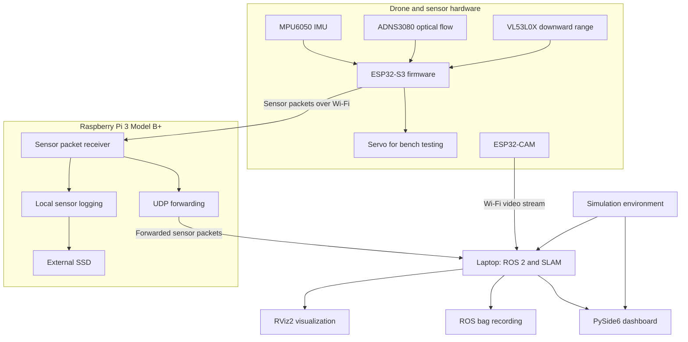

<div align="center">

# BEE-BRAIN

### Bio-inspired perception, embedded control, and offboard mapping for an indoor micro-drone

**Sense locally. Estimate motion. Map offboard.**

[](firmware/platformio.ini)
[](dashboard/)
[](docs/)
[](#current-status)

</div>

---

## Overview

Bee-Brain is an experimental, GPS-free indoor micro-drone project exploring lightweight motion sensing, embedded control, visual mapping, and robotics software. The system separates fast hardware-facing work from computationally intensive mapping: the ESP32-S3 acquires measurements from the onboard sensors, a Raspberry Pi 3 Model B+ forwards and records sensor packets, and a laptop runs the mapping pipeline and ground-control dashboard.

The mapping plan is staged. We will first collect repeatable datasets and work toward a useful 2D room representation. After validating calibration, localization, and data quality, we will investigate higher-quality 3D reconstruction from additional viewpoints and suitable camera or depth information.

> **Development status:** The repository contains a modular firmware scaffold and a PySide6 dashboard. A basic ESP32-S3 PlatformIO build has been verified locally. Physical sensor integration, end-to-end streaming, SLAM, and mapping accuracy still require implementation and validation.

## Contents

- [Project goals](#project-goals)
- [System architecture](#system-architecture)
- [Hardware](#hardware)
- [Data flow](#data-flow)
- [Mapping roadmap](#mapping-roadmap)
- [Software stack](#software-stack)
- [Repository layout](#repository-layout)
- [Build the firmware](#build-the-firmware)
- [Telemetry contract](#telemetry-contract)
- [Team responsibilities](#team-responsibilities)
- [Development workflow](#development-workflow)
- [Current status](#current-status)
- [Limitations and safety](#limitations-and-safety)
- [Documentation](#documentation)

## Project goals

1. Establish reliable sensor acquisition and embedded telemetry on the ESP32-S3.
2. Use the MPU6050, ADNS3080, and VL53L0X to experiment with attitude, altitude, and short-term relative-motion estimation.
3. Stream camera frames from the ESP32-CAM to a laptop for visual perception experiments.
4. Use the Raspberry Pi 3 Model B+ as a telemetry relay and local data logger, not as the primary SLAM computer.
5. Build and validate a 2D mapping workflow before attempting more detailed 3D reconstruction.
6. Integrate sensor data, mapping outputs, and diagnostics into the existing PySide6 dashboard.
7. Keep simulated data separate from real hardware data and compare estimates against simulator ground truth during development.
8. Explore bio-inspired motion-processing concepts, including Reichardt/EMD-style motion detection and LGMD-inspired looming detection, as modular research components.

## System architecture



The diagram describes the target architecture, not a claim that every link is already implemented. The exact transport, message definitions, timestamps, and camera integration will be validated during integration.

### Responsibilities by device

| Device or system | Primary responsibility | Not its initial responsibility |
|---|---|---|
| Seeed Studio XIAO ESP32-S3 | Read physical sensors, perform basic embedded processing, run servo tests, transmit sensor packets | Room-scale SLAM or dense 3D reconstruction |
| ESP32-CAM | Capture images and stream video over Wi-Fi directly to the laptop | Running the SLAM algorithm itself |
| Raspberry Pi 3 Model B+ (2017) | Receive sensor packets, forward them to the laptop over UDP, and log sensor data to an external SSD | Running the primary SLAM workload or Gazebo simulation |
| Development laptop | Run ROS 2, evaluate the SLAM pipeline, visualize mapping results, record datasets, and run the dashboard | Replacing the embedded sensor-acquisition responsibilities |
| Simulation | Provide a controlled virtual environment, synthetic measurements, and ground-truth state for testing | Standing in for physical validation |

The camera stream is intended to travel directly from the ESP32-CAM to the laptop. Sensor telemetry is intended to travel from the ESP32-S3 to the Raspberry Pi, then be forwarded to the laptop and logged locally on the Pi.

## Hardware

### Current prototype and planned roles

| Component | Role | Notes |
|---|---|---|
| Seeed Studio XIAO ESP32-S3 | Embedded controller | Main target for sensor firmware and packet generation |
| ADNS3080 | Downward optical-flow sensor | Provides local image-motion measurements; needs calibration and a suitable visible surface |
| VL53L0X | Downward time-of-flight sensor | Measures distance in its sensing direction; supports ground-clearance estimation when mounted downward |
| MPU6050 | Accelerometer and gyroscope | Supports attitude and motion estimation; has no magnetometer |
| Servo | Initial bench actuator | Test actuator only; do not assume it controls flight motors |
| ESP32-CAM | Video source | Intended to stream camera frames directly to the laptop |
| Raspberry Pi 3 Model B+ (2017) | Companion computer | Packet forwarding and local logging; 1 GB RAM is limited for heavier robotics workloads |
| External SSD | Local data storage | Used by the Pi for sensor logs; actual capacity, format, power, and sustained write performance must be checked |
| Ground Station Control | Mapping and development host | Intended to run ROS 2, the chosen SLAM pipeline, RViz2, rosbag recording, and the dashboard |

The final airframe, flight controller, motors, ESCs, propellers, battery, and complete flight-power design are not confirmed by this architecture description. Do not treat the bench prototype as a flight-ready vehicle.

## Data flow

### Sensor telemetry

1. The ESP32-S3 reads the MPU6050, ADNS3080, and VL53L0X.
2. Firmware attaches timestamps, sequence numbers, sensor validity, and documented units to the measurements.
3. The Raspberry Pi receives the packets, forwards them to the laptop over UDP, and saves a local sensor log on the external SSD.
4. Laptop-side software receives the stream and makes the data available to the ROS 2 pipeline and development tools.
5. ROS bags can be recorded on the laptop for repeatable offline experiments. Pi-side logs provide a separate data copy for recovery and comparison.

UDP does not guarantee delivery or packet ordering. Sequence numbers and packet-loss statistics should be used to identify gaps. The receiver should validate packets before forwarding or recording them.

### Video

The ESP32-CAM is intended to stream video directly to the laptop to avoid routing high-bitrate video through the Raspberry Pi unnecessarily. The video pipeline must be tested for actual frame rate, end-to-end latency, dropped frames, and timestamps. Camera calibration is required before relying on metric reconstruction.

## Mapping roadmap

The project will progress in stages rather than attempting complete room-scale SLAM immediately.

### Stage 1 — Reliable data acquisition

- Read and validate each physical sensor independently.
- Define units, coordinate frames, timestamps, sequence numbers, and error flags.
- Establish camera streaming and measure its actual performance.
- Verify Pi packet forwarding and SSD logging.

### Stage 2 — 2D mapping experiments

- Record repeatable datasets in a controlled indoor area.
- Choose a mapping pipeline compatible with the available camera and range data.
- Visualize trajectories and mapping output in RViz2 where supported.
- Compare estimated movement with known test motions and evaluate accumulated drift.

A 2D occupancy map requires observations that constrain walls or obstacles. The downward-facing ADNS3080 and single-point VL53L0X do not by themselves provide a room-wide scan. Sensor suitability must be demonstrated rather than assumed.

### Stage 3 — Improve localization and data quality

- Calibrate the camera and sensors.
- Check timestamp alignment and coordinate transforms.
- Evaluate camera tracking, loop closure, and trajectory correction where supported by the selected algorithm.
- Repeat tests under different lighting, surface texture, and motion conditions.

### Stage 4 — 3D reconstruction

- Collect video from multiple viewpoints with sufficient visual overlap.
- Estimate camera poses and verify scale where metric dimensions are required.
- Combine valid observations into a point cloud and, where the data supports it, a mesh.
- Inspect gaps, drift, alignment errors, and reconstructed dimensions against known references.

A 2D map does not automatically become a 3D mesh. Monocular video can support visual mapping, but reliable metric 3D reconstruction depends on camera calibration, viewpoint variation, tracking quality, and scale constraints. A depth camera or LiDAR may be needed if the camera-plus-ToF configuration cannot produce the required room geometry.

### Candidate software

The target direction is ROS 2 on the laptop, with a SLAM pipeline selected after camera and data tests. ORB-SLAM3 and RTAB-Map are candidates to evaluate, not interchangeable drop-in components. The correct choice depends on camera input format, monocular/stereo/depth availability, ROS 2 integration, and the mapping output required. RViz2 and ROS bags will support visualization and repeatable testing when integrated.

## Software stack

| Layer | Technology or choice | Status |
|---|---|---|
| Embedded firmware | C++ / Arduino framework / PlatformIO | Build scaffold present; real sensor integration remains in progress |
| Microcontroller | Seeed Studio XIAO ESP32-S3 | Target board configured in PlatformIO |
| Sensor acquisition | MPU6050, ADNS3080, VL53L0X | Integration and physical validation pending |
| Camera | ESP32-CAM Wi-Fi video stream | Target design; performance testing pending |
| Companion computer | Raspberry Pi 3 Model B+ | Intended for UDP forwarding and SSD logging |
| Laptop robotics stack | ROS 2 | Environment and version compatibility to be validated |
| SLAM | ORB-SLAM3 or RTAB-Map | Candidate pipeline; final selection pending data tests |
| Mapping visualization | RViz2 | Intended ROS 2 visualization tool |
| Data recording | ROS bags and Pi-side logs | Integration pending |
| Dashboard | Python / PySide6 | Existing application with six pages |
| Simulation | ROS 2 + Gazebo preferred for evaluation; MuJoCo + Python fallback if required | Minimal simulation environment and runtime compatibility still to be verified |
| Point-cloud and mesh processing | Open3D where appropriate | Use after mapping data pipeline is validated |
| Version control | Git and GitHub pull requests | Used for collaborative development |

## Repository layout

```text
drobee/
├── README.md
├── LICENSE
├── .gitignore
├── cad/
│   ├── scripts/
│   ├── step/
│   └── stl/
├── dashboard/
│   ├── app.py
│   ├── database/
│   ├── mapping/
│   ├── services/
│   ├── static/
│   ├── templates/
│   ├── tests/
│   └── ui/
├── docs/
│   ├── architecture/
│   ├── hardware/
│   ├── research/
│   └── telemetry/
├── firmware/
│   ├── platformio.ini
│   ├── include/
│   ├── lib/
│   ├── test/
│   └── src/
│       ├── bio/
│       │   ├── lgmd/
│       │   └── reichardt/
│       ├── communication/
│       │   └── telemetry/
│       ├── control/
│       │   ├── motor_mixer/
│       │   ├── pid/
│       │   └── state_estimation/
│       ├── safety/
│       │   └── failsafe/
│       └── sensors/
│           ├── adns3080/
│           └── vl53l0x/
├── simulation/
│   ├── algorithms/
│   ├── controllers/
│   ├── sensors/
│   └── worlds/
└── tests/
    ├── integration/
    └── test_data/
```

This is a guide to the current project organization. Some directories may be empty or contain scaffolding while their implementations are being developed.

## Build the firmware

The firmware project uses PlatformIO with the Arduino framework and the Seeed Studio XIAO ESP32-S3 board definition.

### Windows with Git Bash

From the repository root, using the project's virtual environment:

```bash
./.venv/Scripts/python.exe -m platformio run -d firmware
```

### macOS or Linux

If PlatformIO is installed in a virtual environment at `.venv`:

```bash
./.venv/bin/python -m platformio run -d firmware
```

If PlatformIO is installed in the active environment instead, the equivalent command is:

```bash
pio run -d firmware
```

The first build downloads the PlatformIO platform and required toolchains. A successful compile verifies buildability only; it does not confirm that sensors are wired correctly, firmware works on physical hardware, or flight behavior is safe.

### Dashboard

Run the existing dashboard from the repository root using the environment and command appropriate to the host OS. On Windows, the established project command is:

```powershell
.venv\Scripts\python.exe -m dashboard.ui.main_window
```

Confirm the required dashboard dependencies are installed from the project's dependency file before launching the application.

## Telemetry contract

The established baseline telemetry fields include `altitude_cm`, `drift_x`, `drift_y`, and `battery_v`. The final packet format must remain aligned across firmware, Raspberry Pi software, the laptop ROS 2 pipeline, and dashboard consumers.

Illustrative logical packet (not a substitute for the canonical project specification):

```json
{
  "schema_version": 1,
  "sequence": 1042,
  "timestamp_us": 83421000,
  "altitude_cm": 98.5,
  "drift_x": 0.12,
  "drift_y": -0.04,
  "battery_v": 3.9,
  "sensor_status": {
    "imu": true,
    "optical_flow": true,
    "tof": true
  }
}
```

The numbers above are examples only. Units and coordinate conventions for drift must be explicitly defined before implementation. Invalid measurements must be marked as invalid or omitted according to the canonical schema; they must not be silently replaced with plausible-looking values. Flight-motor fields should only be added once the actual flight hardware and telemetry requirements are confirmed.

The detailed schema should live in the project's telemetry specification under `docs/telemetry/` and be treated as the source of truth.

## Team responsibilities

| Role | Primary ownership | Key deliverable |
|---|---|---|
| Firmware duo — sensor drivers | ESP32-S3 setup and MPU6050, ADNS3080, and VL53L0X integration | Independently tested sensor drivers and documented wiring/interfaces |
| Firmware duo — integration | Acquisition loop, timestamps, status flags, packet schema, UDP transmission | Integrated sensor telemetry firmware |
| Solo firmware developer | ESP32-CAM capture and Wi-Fi video stream | Repeatable stream to the laptop with measured performance |
| Raspberry Pi / SLAM developer | Pi receive/forward/log software; laptop ROS 2 and SLAM integration | Sensor forwarding, SSD logs, recorded datasets, first mapping experiment |
| Dashboard / simulation developer | PySide6 dashboard, simulation, telemetry integration, mapping visualization | Dashboard connected to simulated and later physical data |
| Hardware testing and integration | Shared responsibility by the person testing the physical setup | Wiring validation, upload tests, measured behavior, reproducible test notes |

Roles can overlap, but each deliverable should have one directly responsible owner. Firmware contributors should provide the complete source changes, dependencies, build commands, and test notes for hardware validation.

## Development workflow

Use feature branches and pull requests rather than committing directly to protected branches.

Recommended workflow:

```text
Create feature branch
        |
Implement a small change
        |
Build and run available tests
        |
Commit and push
        |
Open pull request
        |
Review and required checks
        |
Merge after approval
```

Example:

```bash
git switch -c feature/esp32-s3-sensors
```

Keep changes focused and avoid editing the same files from multiple branches where possible. Coordinate shared interfaces before parallel implementation, especially telemetry schemas, sensor coordinate frames, timestamps, and camera transport.

The firmware build workflow is being added to `.github/workflows/`. GitHub branch protection and required-review settings must be configured separately in repository settings; a workflow file alone does not enforce approvals.

## Current status

| Area | Status | Next validation step |
|---|---|---|
| Repository structure | Established | Keep module ownership and documentation aligned with actual files |
| ESP32-S3 PlatformIO configuration | Present | Continue incremental compile checks |
| Firmware entry point | Basic Arduino `setup()` / `loop()` scaffold compiles locally | Integrate real sensor initialization without losing buildability |
| MPU6050 integration | Pending | Read and validate real measurements on hardware |
| ADNS3080 integration | Pending | Validate sensor communication, surface motion response, and sign conventions |
| VL53L0X integration | Pending | Validate range readings and invalid/out-of-range behavior |
| Servo test | Pending | Verify pin, power, limits, and safe startup behavior |
| ESP32-CAM stream | Planned | Measure actual frame rate, latency, and reconnect behavior |
| Raspberry Pi UDP forwarding | Planned | Validate packets end-to-end and record sequence gaps |
| External SSD logging | Planned | Verify mount, write reliability, and recovery after interruption |
| ROS 2 / SLAM | Planned | Choose compatible software versions and test with recorded camera data |
| 2D mapping | Planned | Validate sensors and produce a repeatable map dataset |
| 3D reconstruction | Future stage | Confirm adequate viewpoint coverage, calibration, and scale information |
| PySide6 dashboard | Existing application | Integrate real telemetry and mapping outputs incrementally |
| Gazebo runtime | Not yet verified in the target environment | Test a minimal world before building a full drone model |

Update this table as work is actually tested. Do not mark a feature complete solely because code exists or compiles.

## Limitations and safety

- The project is experimental. The current firmware build is not a declaration of flight readiness.
- The downward-facing ADNS3080, single-point VL53L0X, and MPU6050 support motion-estimation experiments but do not, by themselves, provide complete room geometry for robust room-scale SLAM.
- Visual SLAM and metric 3D reconstruction require suitable calibration, valid camera tracking, adequate viewpoint variation, and scale constraints.
- Monocular video may not provide a reliable absolute scale without additional constraints or suitable sensor fusion.
- A UDP stream can lose or reorder packets. Use sequence numbers, timestamps, and receiver-side validation.
- Camera and sensor clocks may differ. Timing and camera-to-sensor alignment must be measured and handled explicitly.
- The Raspberry Pi 3 Model B+ has limited compute and memory resources; the laptop is the intended host for computationally demanding SLAM.
- Keep flight-critical stabilization and failsafe behavior onboard the flight-control system. Do not rely on a laptop or Wi-Fi round trip for a fast stabilization loop.
- Validate power rails, logic levels, GPIO assignments, and current requirements before connecting hardware. Do not power a servo directly from a GPIO pin.
- Do not attempt flight testing until the flight hardware, motor-control design, failsafe behavior, and controlled test procedure have been reviewed.

## Documentation

Use the repository's `docs/` tree for detailed design records:

- `docs/architecture/` — system architecture and interfaces.
- `docs/hardware/` — wiring, pin mapping, and hardware constraints.
- `docs/research/` — algorithm research and experiments.
- `docs/telemetry/` — canonical telemetry fields, units, and packet definitions.

The README is the project overview. Detailed schemas and implementation behavior should be documented in their relevant files under `docs/` and kept synchronized with code.

---

<div align="center">

**Bee-Brain**

*Bio-inspired perception. Embedded experimentation. Offboard mapping.*

</div>
